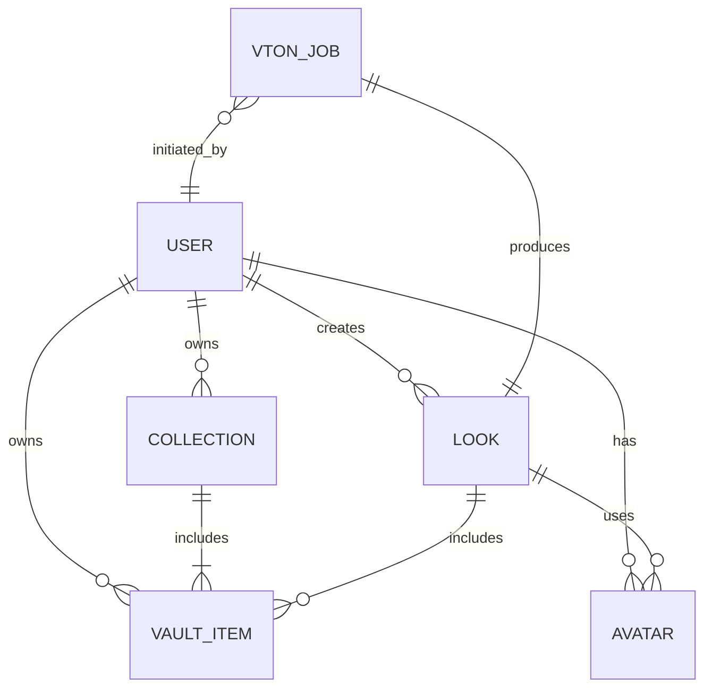
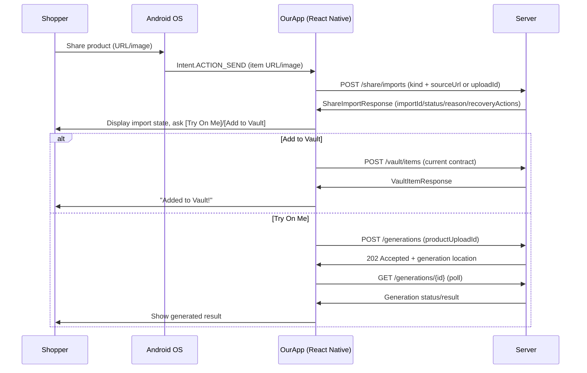
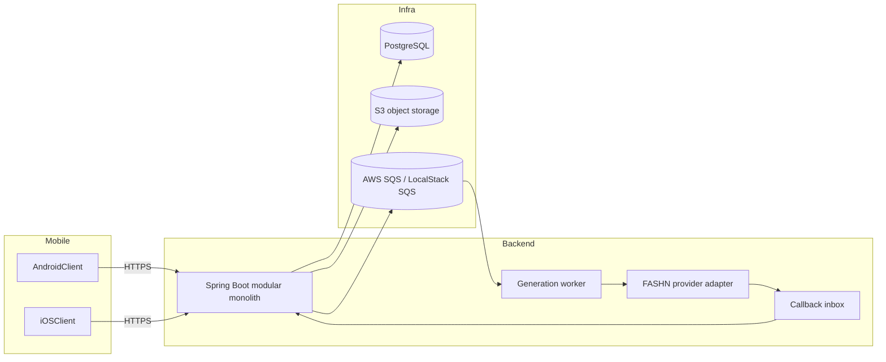
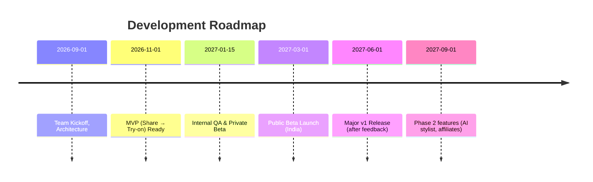

# Executive Summary  

This document defines a **share-first consumer virtual try-on app** that lets shoppers see outfits on their own image by sharing items from any shopping app into our mobile app. Users can “Share → Vault → Studio → Looks” to import garments, build a personal wardrobe, compose outfits with their AI avatar, and save/share the generated images. The **value proposition** is clear: shoppers gain confidence and reduce returns by virtually trying on clothes anywhere, not just on merchant sites. Google’s recent launch of a full-body try-on from a selfie (billions of items via its Shopping Graph) validates demand for this exact capability. Our advantage is a **persistent personal fashion workspace** (Vault of saved items, AI studio, saved looks) rather than a one-off try-on.  

This PRD covers user personas, features, architecture, data/privacy, and execution. Key highlights: target young, tech-savvy fashion shoppers; core flows include Android Sharesheet and iOS Share Extension for importing items, avatar onboarding, and an interactive multi-item outfit builder; V1 scope is focused on basic share, vault, and single/multi-item AI try-on; future phases add personalization (style suggestions), social sharing, and commerce integrations. All personal images are handled **ephemerally** and with **user consent** in compliance with India’s new DPDP 2025 privacy law (explicit consent, right to erase). We benchmark major AI providers (FASHN, Genlook, Pixelcut) on speed, cost, fidelity, and privacy (e.g. FASHN does not train on customer images, Pixelcut deletes inputs in 24h).  

Deployment will use a mobile-first tech stack (React Native + Spring Boot backend), cloud storage (S3), and modern practices (webhooks, async jobs, quality gating). We outline metrics (user engagement, try-on conversion, cost per generation), A/B tests (UI flows, prompts), timelines, and team structure. Milestones include prototyping the share-to-avatar pipeline, testing offline generation quality, and beta launch in the India market. We include tabular comparisons, API examples, database schemas, Mermaid diagrams (architecture, ER, timeline), and practical checkpoints. The go/no-go criteria hinge on user uptake of sharing flows, AI output quality, and business viability (e.g. acceptable cost per try-on relative to engagement).

## Target Users & Personas  

- **Fashion-Shopping Millennials/Gen Z:** App-savvy 20–40 year-olds (both genders) who frequently buy clothes online (Myntra, Ajio, Instagram shops, etc.) and value tech solutions.  
- **Trend-Forward Women:** e.g. “Rajni, 28, Bangalore – loves ethnic fusion wear, browses Myntra & Insta, hates fitting room mismatches.” She’s likely to share items into the app and build looks.  
- **Casual Male Shoppers:** e.g. “Arjun, 32, Delhi – buys shirts and sneakers from Flipkart/Amazon. Prefers a quick try-on before ordering.”  
- **Tech Enthusiasts:** Early adopters interested in AI and virtual reality experiences.  

**Pain Points:** Uncertainty how clothes will look/fit, high return rates, lack of in-person try-on, forgetfulness of liked items.  

**Goals:** Preview clothes on themselves without extra effort; curate a “digital wardrobe” of liked items; get style suggestions; confidently purchase.  

## Value Proposition  

1. **Always Try On Anything:**  One-tap try-on from any shopping app via the mobile share menu. See “myself wearing it” instantly. (Google’s try-on tool now offers this on billions of products.)  
2. **Personal Vault:** Build a persistent wardrobe of garments (photos and metadata) in categories (tops, bottoms, ethnic wear, footwear, accessories). Unlike ephemeral screenshots, users keep a library of everything they liked.  
3. **AI-Enhanced Mixing:** The Studio lets users combine items into outfits on their own avatar, with voice/text prompts or manual picks. The AI handles realistic compositing of multiple items (shirt + pants + shoes, etc.).  
4. **Saved Looks:** Generated outfits can be saved and shared (e.g. “Look of the day,” or share on social). Over time the app learns user style via saved items and selections.  

This addresses the high return/abandonment rates in fashion e-commerce (27–40% of apparel online gets returned). For example, a retailer with a 26% return rate would benefit from try-on to boost confidence. By saving liked items in the Vault and using them repeatedly, the app increases engagement and ROI vs. one-off demos.  

## Core User Journeys  

1. **Share Import:** User finds a garment on any shopping app or website (e.g. Myntra, Instagram). They tap the **Share** button and select *OurApp* from the share sheet. The app receives either a product URL and/or image blob. The **Import Resolver** (backend) extracts the product image, name, source, and attributes. The user sees a preview of “Black Oversized Shirt from Myntra” and is prompted to *Try on me* or *+ Add to Vault*.  
2. **Vault Management:** When adding an item, the app asks for category or auto-classifies it (top, trouser, saree, etc.) via a fashion classifier. Items are stored in the user’s Vault with metadata (image, link, brand). Users can create named collections (e.g. “Wedding”, “Wishlist”) and drag items into them. Vault browsing shows filters by category (Tops, Bottoms, Footwear, etc.) and collections.  
3. **Avatar Onboarding:** On first use (or via Profile), the user creates their avatar (“My Model”). They upload or take a **full-body photo** in good lighting (instructions given). We store 1–3 poses of the user (front, 3/4) for variety. The app may allow retakes for better quality. This avatar is the basis for all try-ons (private to user). Users consent to processing of this image under our privacy policy.  
4. **Studio Composition:** In the Studio, the user sees their avatar (“YOU”) and can assemble an outfit. The interface shows “head, upper body, lower body, footwear, accessories” slots. Users can type text commands (“Add my white sneakers from vault”) or tap “+ Add from Vault” to pick items. The app guides them: after selecting top and bottom, it might suggest matching shoes or bag from their Vault. The state machine ensures logical outfits (e.g. you can’t have both a “Full Body lehenga” and separate top+bottom – one overrides the other). Users can replace or remove items.  
5. **Multi-Item VTON Flow:** Once the outfit is ready (1+ items selected), the user taps **Generate**. This triggers sequential AI try-on: the system applies items one at a time in order (e.g. first shirt, then pants, then shoes). Each step’s result seeds the next to preserve pose and identity. After each step, a quick low-res preview can be shown. On completion, the **Quality Gate** checks for obvious errors (garment distortion, misalignment). If pass, the final “Generated Look” is shown. If fail, the user is offered to retry or simplify the outfit.  
6. **Save/Share Looks:** Satisfied with a look, the user taps **Save Look**. The look (image + metadata of items) goes into their *Looks* gallery. Users can browse “Today’s Looks”, “Yesterday”, etc. They can share saved looks (e.g. to friends or social media) or click through to any product’s purchase link (each saved look overlays item cards that link back to the retailer).  

These flows work across Android and iOS with platform-specific UX: on Android, the Share action immediately opens the app; on iOS, a lightweight Share Extension UI handles the import (see **UX Section** below). The backend orchestrates all steps (import, storage, VTON jobs).  

## Feature List (V1 & Roadmap)  

- **Scope V1 (“MVP”):**  
  - *Share Integration:* Android Sharesheet receiver; iOS Share Extension to import URL or image of a garment.  
  - *Import Resolver:* Backend scraping of known retailers (Myntra, Ajio, Amazon, Instagram, etc.) for high-quality product images and metadata (name, brand, category). Fallback: allow user to crop a screenshot if scraping fails.  
  - *Vault:* Save items with image, link, auto-detected category, optional tags. Basic Vault UI with filters by category and date.  
  - *Collections:* User-defined folders (e.g. “Wedding 2026”, “Wishlist”), assign items to multiple collections.  
  - *Avatar Profile:* User can upload or take photo, with guidance for best results. Store avatar(s) securely.  
  - *Try-On (Single-Item):* Given user avatar + single garment, integrate with one VTON provider (initially FASHN v1.6 for speed or Genlook for simplicity) to render. Show immediate preview.  
  - *Outfit Studio (Multi-Item):* Allow adding multiple Vault items into an outfit composition. Manage slots (upper/lower/footwear, etc.). Generate final multi-item image (using sequential calls or multi-input API).  
  - *Quality Check:* Automated sanity checks (e.g. ensure face and body of avatar still visible, garment matches outline). Flag failures (e.g. 画).  
  - *Save Looks:* Save generated images with metadata (items, timestamp). Gallery view grouped by date. Shareable links to each look.  
  - *Privacy & Settings:* Explicit user consent on onboarding (avatar use, privacy notice). Ability to delete avatar and data. Minimal retention of images (e.g. 72h).  
  - *Analytics:* Track key events (shares, try-ons, saves) for metrics.  

- **Roadmap Phases:**  

  | Phase | Features (example)                                  | Timeframe (from launch) |
  |:-----:|:----------------------------------------------------|:------------------------|
  | **P1 (MVP)**  | Share import, Vault (items & collections), Avatar onboarding, Studio (1-3 items), Save/Looks, Basic notifications | 0–6 months |
  | **P2**       | Enhanced UI (real-time previews), AI studio assistant (recommend matching items from Vault), Variation Generation (multiple AI images/ look variants), Chatbot styling interface, Affiliate linking (show price, “Buy” buttons) | 6–12 months |
  | **P3**       | Social features (follow friends, share Looks feed), Multi-Avatar (alternate poses), Personalized Style Q&A (“What should I wear tomorrow?”), Retailer partnerships (in-app product catalogs), AR try-on extension | 12–24 months |

(Features marked for later phases should only be prototyped if early adoption is strong, due to complexity.)

## Data Model  

Key entities and relationships:



- **User:** (id, name, email/phone, settings)  
- **Avatar:** (id, user_id, image_url, pose_label, created_at) – user’s saved model images.  
- **Vault_Item:** (id, user_id, image_url, source_url, retailer, name, category, color_tags, created_at) – saved garment entries.  
- **Collection:** (id, user_id, name)  
- **CollectionItem:** (collection_id, vault_item_id) – join table for many-to-many (one item can be in multiple collections).  
- **StudioSession:** (id, user_id, avatar_id, status, created_at) – ephemeral session state while composing an outfit.  
- **StudioItem:** (id, session_id, vault_item_id, slot) – items currently in composition (slot e.g. “upper”, “lower”, “shoes”).  
- **VTON_Job:** (id, session_id, provider, status, attempt_count, created_at) – tracks an AI generation job.  
- **QualityCheck:** (job_id, score_overall, passed(bool), issues_text) – result of automated QC.  
- **Look:** (id, user_id, image_url, studio_session_id, created_at) – final saved outfit.  
- **Notification:** (id, user_id, type, related_look_id, seen, created_at) – for “Your look is ready” etc.  
- **Audit/Consent:** (id, user_id, consent_type, timestamp) – record of user consent to DPDP terms, data use.  

*Example Schema Snippet:*  
```sql
CREATE TABLE user (
  id SERIAL PRIMARY KEY, name TEXT, email TEXT UNIQUE, 
  ... -- hashed, etc.
);

CREATE TABLE avatar (
  id SERIAL PRIMARY KEY, user_id INT REFERENCES user(id), 
  image_url TEXT, pose TEXT, created_at TIMESTAMP
);

CREATE TABLE vault_item (
  id SERIAL PRIMARY KEY, user_id INT REFERENCES user(id),
  image_url TEXT, source_url TEXT, retailer TEXT,
  category TEXT, attrs JSONB, created_at TIMESTAMP
);

CREATE TABLE collection (
  id SERIAL PRIMARY KEY, user_id INT REFERENCES user(id), name TEXT
);
CREATE TABLE collection_items (
  collection_id INT REFERENCES collection(id),
  vault_item_id INT REFERENCES vault_item(id),
  PRIMARY KEY (collection_id, vault_item_id)
);

CREATE TABLE look (
  id SERIAL PRIMARY KEY, user_id INT REFERENCES user(id),
  image_url TEXT, session_id INT REFERENCES studio_session(id),
  created_at TIMESTAMP
);
```
This relational model supports queries like “get all tops in user’s Vault” or “items in ‘Wedding 2026’ collection.” Vault items and looks store only image URLs (to S3) and links, minimizing on-chain image data.

## API Contracts  

The current HTTP contract is maintained in [API_CONTRACTS.md](API_CONTRACTS.md) and the source-confirmed route census in [CONTRACT_INVENTORY.md](CONTRACT_INVENTORY.md). The examples below use those mounted routes; unmounted Studio and quality routes are explicitly marked **PROPOSED**.

- **Mobile share/import (current):** `POST /share/imports` accepts `{ "kind": "URL", "sourceUrl": "https://www.myntra.com/rare-rabbit-black-shirt" }` (or an `uploadId` for staged media) and returns `{ "importId": "...", "status": "...", "reason": "...", "recoveryActions": [...] }`. `GET`, `PUT /share/imports/{importId}/image`, and `DELETE /share/imports/{importId}` are also mounted. See the contract inventory for exact optional fields and idempotency rules.
- **Vault and collections (current):** `GET/POST /vault/items`, `PATCH/DELETE /vault/items/{id}`, and the mounted `/collections` routes.
- **Avatars (current):** `POST/GET /avatars`, plus the mounted item routes. Avatar creation consumes an existing upload capability; the API does not expose the obsolete `/api/avatar` form.
- **Generation (current):** `POST /generations` returns `202 Accepted` with a generation location; `GET /generations/{generationId}` and `POST /generations/{generationId}/cancel` are mounted. The backend queues durable work in AWS SQS (LocalStack locally) and the worker invokes the registered provider adapter.
- **Studio and quality routes (PROPOSED / unmounted):** `/studio/sessions/**` and a standalone quality endpoint are backlog contracts, not current APIs. Do not integrate against them until a controller and contract tests are mounted.

Mobile clients therefore talk to the mounted backend routes; the backend owns provider integration through its adapter. API shape changes must follow the contract inventory and contract tests.

## Security & Privacy  

- **User Consent:** On onboarding, users explicitly consent to *processing* of their body image for try-on and agree to privacy terms (in regional languages as required by DPDP). We never use their photos for other purposes.  
- **Data Minimization:** Only store what’s needed: the user’s avatar images, and Vault item images/links. We encourage *ephemeral* handling when calling AI providers: use short-lived signed URLs or Base64 per FASHN guidance so provider cannot keep the image beyond processing. By default, outputs (generated images) expire in 3 days on FASHN’s CDN unless retrieved. Pixelcut likewise deletes outputs within 24h.  
- **No Training on User Data:** We do **not** share user images with any training pipeline. For example, FASHN explicitly states they do **not** use customer content to train models; Pixelcut confirms zero data retention and no training. We enforce similar policy with any provider.  
- **Storage & Encryption:** All images at rest (avatars, Vault, looks) are encrypted in our secure cloud storage (e.g. AWS S3 with server-side encryption). All API communication is HTTPS/TLS.  
- **User Rights:** Per India’s DPDP Act and Rules, users can request deletion of their personal data at any time. We provide a “Delete My Data” option that purges the user’s Vault, avatars, and any logs. We record this request in our audit trail.  
- **Locality:** Data is stored in servers located in India to comply with any local data governance (cross-border issues).  

> **Privacy Summary:**  We handle images like sensitive personal data. Following DPDP 2025, we get clear consent and limit retention. Providers are used in the most privacy-preserving way: either via ephemeral Base64 delivery or short-lived URLs, and outputs expire quickly. (User photos and generated looks belong to the user.)  

## AI Provider Benchmarking  

We will evaluate candidate VTON APIs on **fidelity, latency, cost, and privacy**. Key contenders: **FASHN (Try-On v1.6 and Try-On Max)**, **Genlook**, and **Pixelcut**. Other solutions (Google, ASOS/AIUTA) lack open APIs, but we note: Google now offers a consumer feature (nano-banana) that users will compare us against.  

| Provider / Model    | Latency (median)               | Output Quality            | Pricing                        | Privacy Features                       | Notes                       |
|---------------------|--------------------------------|---------------------------|--------------------------------|----------------------------------------|-----------------------------|
| **FASHN Try-On v1.6** | 5–17 seconds per image | Standard fidelity (576×864) | $0.075/image base (with *1–5 credits* by mode) | **Images auto-delete:** FASHN deletes inputs/outputs after ~72h. No free credits (min $7.50 spend). | Good for real-time preview (fast). Lower res.  |
| **FASHN Try-On Max** | 20–120 seconds (for high-res) | High fidelity (up to 4K output) | Credits-based (1–5 credits/image; ~ $0.075+ per image) | Same retention as above (72h deletion).            | Best detail; slow/costly for high-res.  |
| **Genlook (VTO)**   | ~9.3 seconds         | Photorealistic (shared demos 1024×1024+) | $0.08/image (volume $0.065) | Provides **user records** & deletion endpoint. Images auto-expire; 5 free credits trial. | One fixed endpoint for *any garment* (clothing, shoes, hats, jewelry). |
| **Pixelcut VTO**    | (not published; likely a few sec) | Advanced draping & detail | 10 credits ($0.10)/image    | Zero input retention; outputs deleted in 24h; no training.  | APIs geared to e-commerce; mobile/device clients. |

- **Multi-item support:** Genlook and Pixelcut currently focus on one garment per generation; we would implement multi-item outfits by sequential calls (as we do with FASHN).  
- **Quality notes:** FASHN’s Try-On Max excels at preserving patterns/textures (trained on 18M garments), while Genlook promises consistent speed and user privacy. Pixelcut claims “detail preservation” and handles diverse body types.  

We will **benchmark offline** using a curated dataset: e.g. 50 diverse avatar photos × 100 garment images (tops, ethnic dresses, jeans, shoes, etc.). Each combo is run through the providers. **Metrics:**  
  - *Garment fidelity:* e.g. structural similarity (SSIM) or perceptual loss vs. a ground truth on-model image.  
  - *Color/pattern accuracy:* measure color histogram difference.  
  - *Identity preservation:* face detector confidence (was it still “me”?).  
  - *Pose accuracy:* verify body landmarks alignment.  
  - *User studies:* rank realism (optional for pass threshold).  
  - *Latency & cost:* record ms and API credits.  

**Thresholds:** We might require e.g. ≥90% of outputs have no major artifact, and each garment’s key features (logo, print) remain recognizable. A pass/fail criterion could be “Artifact Score < 0.1” and SSIM > 0.8.  

These benchmarks will guide our final provider choice and parameter settings. For example, if Genlook’s $0.08 cost and 9s speed deliver >95% fidelity on our test set, it may be preferred for V1; if FASHN yields richer output but at 5× the latency, we might only use it for “HD Looks” on-demand.

## Offline Experiment Design  

To validate before launch, we design an experiment:  
- **Dataset:** ~100 garments covering categories (60% Indian ethnic wear, 40% western casual: tops, sarees, lehengas, jeans, shirts, shoes). 20 diverse volunteers with varied body shapes pose and submit 3 photos each (controlled lighting/background).  
- **Procedure:** For each (avatar, garment) pair, call each provider (via our backend) and collect output. Also create synthetic combinations (avatar + shirt + trouser + shoes).  
- **Metrics:**  
  - *Visual Fidelity:* Use image similarity metrics (SSIM, LPIPS) comparing AI output vs. a reference photo (if available). Otherwise, employ a human rater panel to score quality (1–5).  
  - *Color/Pattern match:* Compute color histogram overlap.  
  - *Identity retention:* Face detection on output to ensure the person is recognizable; e.g. similarity of face embedding between original photo and try-on image (OpenFace or AWS Rekognition).  
  - *Failure rate:* Rate how often outputs are unusable (garment missing, huge warp, multi-item overlap).  
  - *Latency and throughput:* Actual time to generate (p95 tail).  
- **Pass Criteria:** A provider/config passes if ≥90% of single-item try-ons have “satisfactory” scores (e.g. SSIM>0.9 or human rating ≥4/5) and all multi-item core combinations pass basic sanity. If not, tune prompts or try alternative providers.  

This offline validation ensures we only release features when quality is acceptable. It also informs our **Quality Gate** thresholds and fallback behavior (e.g. if multi-item fails, try individually with “Combine Look” icon instead).

## UX Flows (Android & iOS)  

### Android Sharesheet Integration  

1. **User Action:** In any app (Myntra, browser, Instagram), user taps **Share** on a product.  
2. **Select App:** Android Shows the system Share menu, including *OurApp*. (We register an intent-filter for ACTION_SEND of type text/image in AndroidManifest.)  
3. **Import Screen:** Tapping *OurApp* launches our `ShareImportActivity`. It receives the text/URL or image. The UI shows the product preview (image, title, source). Two big buttons: **“Try On Me”** and **“+ Add to Vault.”**  
4. **Handle Choice:**  
   - *Add to Vault:* Saves item in background, then returns to Vault UI or a confirmation toast.  
   - *Try On Me:* Ensures the user has an avatar (prompt to create if not). Then creates a new Studio session with that item and calls the VTON API to render. The app transitions to the Studio with the user’s avatar + shared item shown.  
5. **Result Notification:** When generation finishes, the Studio shows the “Your Look” screen with the rendered image, plus options “[+ Add another item] [Save Look] [Share]”.  

This flow uses Android’s native sharing (no custom plugins), making it frictionless.  



### iOS Share Extension  

1. **User Action:** In any app on iOS, user taps Share and picks *OurApp* from the iOS share sheet.  
2. **Share Extension UI:** Our iOS Share Extension appears as a small sheet. It immediately shows the shared item (image or link preview) and two actions: **“Try with My Model”** and **“Add to Vault”**. (We list supported types in Info.plist.)  
3. **Extension handling (current):**
   - The share extension stages the accepted image or URL in the shared App Group and writes one handoff record. It does not call the backend, provider, or VTON service directly.
   - The main app discovers the staged record through the host handoff-discovery bridge, emits the share-import route to React Native, and then uses the mounted `/share/imports` contract after normal host authentication. Generation is a separate host-originated flow, not an extension enqueue.
   - The extension completes or cancels after durable staging; it does not wait for a server response.
4. **Notification:** Due to iOS restrictions, we **cannot** directly launch the main app from the extension. Instead, when the server finishes generation, we send an APNs push notification: “✨ Your Look is Ready!” with a deep link in the frozen form `fashionvault://looks/<lowercase-canonical-UUID>`. Tapping it opens the main app to that Look’s detail.

This design avoids hacks (like abusing URL schemes) and aligns with Apple’s guidelines. It ensures the share experience feels complete: *Share → brief confirmation → wait → notification opens result*.  

> *UI Notes:* The share extension UI is streamlined (minimal AutoLayout). We avoid scrolling. It may simply say “Importing [Product Name]...” with spinner.  

### Studio/App Navigation  

- **Bottom Tabs:** Home (empty state / quick actions), Vault, Studio, Looks, Profile.  
- **Home:** Welcomes user, “Recent shares”, “Recent looks”, and a big “Import Item” button (identical to share menu).  
- **Vault:** Shows all saved items grouped by category tabs (Tops, Bottoms, Sarees, Footwear, etc.) and user collections below. Tapping item lets user *Edit* metadata or *Remove*.  
- **Studio:** Always shows “Active Outfit” with avatar on left, slots on right. “Add from Vault” button to browse Vault (slides up panel). Natural language box (“Ask me to change anything…”). A “Generate” button is enabled when >=1 item.  
- **Looks:** Grid of saved looks sorted by date, tap to view details/share.  
- **Profile:** Avatar management, settings (privacy policy, etc.).  

These flows ensure Android and iOS feel consistent despite the underlying differences in share integration.  

## Metrics & KPIs  

We will track both usage and business metrics:  

- **Sharing Engagement:** *Share-to-App rate* = number of share-invocations per app install. Measure how often users use the Sharesheet vs browsing inside the app. High ratio means users like the quick import.  
- **Try-On Conversion:** Percentage of shared items that users actually **Generate** a try-on or **Save to Vault**. (Benchmarks might be 30–50% “Try On” rate as a good initial target.)  
- **Vault Growth:** # of items saved per user, and # of collections created. Repeat usage (items reused in multiple outfits).  
- **Generation Cost:** $ per generation (provider billing) vs. *LTV* (monetization potential). Aim for <$0.10 per try-on in scale.  
- **Quality Reject Rate:** % of generation jobs that fail QC. We want this <5% by iteration 2.  
- **Retention:** Day-1, Day-7 retention rates for users.  
- **Revenue/Conversions:** If using affiliate links, track *Clicks to retailer / purchases*. E.g., *Incremental purchase rate* after try-on > baseline.  
- **User Satisfaction:** NPS or ratings, especially around “Did this look helpful?” prompts.  

**Example KPI Goals (end of Year1):** >20% of users share at least 3 items, >30% of shared items are tried on, average 10 Vault items per active user, <$0.08 cost per generation (using Genlook volume pricing), <10% QC failures.  

We will also track app-specific metrics: DAU/WAU, session length, funnel drop-off (share → imported→ try-on start → complete → save look).  

## A/B Experiment Ideas  

To optimize experience and retention, we plan iterative A/B tests:  

- **Onboarding Wording:** Test different prompts in share extension (“Try on with My Model” vs “Visualize on Me”).  
- **Studio Suggestions:** Toggle recommending Vault items (e.g. “You might also try these pants with your new shirt”). Measure if suggestions increase multi-item outfits.  
- **Prompt vs Buttons:** In the Studio, compare user performance with a text LLM assistant vs. purely UI selection (buttons) for adding items.  
- **Quality Feedback:** Show a warning if quality is low vs. not showing. Does it reduce frustration or drop-offs?  
- **Monetization UI:** If we add “Price & Buy” buttons on saved looks, test clickthrough rate on affiliate links.  
- **Notification Timing:** Instant push vs. delayed (e.g. “Your look is ready in 10s” vs immediate) to see how long users wait.  

Each experiment will have a control and treatment group, tracking downstream conversion metrics to decide winners. (E.g. does adding a “+Add matching pants” suggestion increase the % of users who add a second item?).  

## Backend Architecture & Tech Stack  

V1 uses one feature-modular **Spring Boot** backend (Java) with asynchronous generation workers. The current architecture and route census are canonical in [ARCHITECTURE.md](ARCHITECTURE.md) and [CONTRACT_INVENTORY.md](CONTRACT_INVENTORY.md).



- **Backend:** One Spring Boot modular monolith with feature packages; Vault, Avatar, Import, Look, Notification, and Generation are modules, not separately deployed microservices. No JPA or Redis is part of the current stack.
- **Persistence and queue:** PostgreSQL is the source of truth; S3 stores media. Generation work uses durable AWS SQS, emulated by LocalStack locally.
- **Studio:** The persisted Studio session/controller is **PROPOSED and unmounted**. Do not treat the Studio feature wording or `/studio/**` routes as a deployed service.
- **Provider boundary:** The backend's registered FASHN adapter performs provider calls. Provider selection beyond that registered adapter is not a current contract.
- **Historical proposals:** Redis/RabbitMQ queues and independently deployed Studio/Auth/Vault/Avatar/Look microservices describe historical or future options only; they are not current architecture.
- **Mobile:** React Native with native share hosts. iOS share-extension behavior is App Group staging plus host discovery; it does not make direct extension/backend calls.
- **Notifications and storage:** Notification delivery and S3 media capabilities are backend concerns. Provider inputs use time-boxed capabilities; no direct provider URL is exposed by the share-import response.

The current deployment shape is the modular monolith plus SQS/worker topology. Later service-splitting proposals must be labeled as proposed and linked to their owning contract before implementation.

## Deployment Plan & Timeline  

**Duration:** Approximately 6–9 months to beta launch, 12+ for full launch.  We suggest a *phased rollout* focused on India (where smartphone use and Google VTON demand is high).  

- **Months 1–2:** Team assembly, finalize specs, mockups. Begin development of core backend and simple mobile UI (Vault + Avatar).  
- **Months 3–4:** Implement share import flow (Android and iOS). Launch internal testing of importing from 2–3 retailers. Develop first integration with a VTON provider (FASHN/Genlook) for single-item try-on.  
- **Months 5–6:** Complete Vault UI, Studio UI (select items, prompt box), and multi-item try-on. Implement quality checking. Conduct extensive internal QA; iterate on UI.  
- **Month 7:** **Private Beta:** Release to a small user group (e.g. employees/friends) in India. Collect feedback on share UX, image quality, performance.  
- **Month 8:** Iterate bug fixes, add minor improvements (e.g. Collections, notifications). Begin marketing landing page and documentation.  
- **Month 9:** **Public Beta Launch:** Broad release on Google Play and App Store (India). Monitor KPIs carefully. Begin partnerships (e.g. affiliate networks).  
- **Months 10–12:** Analyze metrics from beta. Implement Phase 2 features (item recommendations, multiple generations, affiliate integration). Plan Phase 3 if warranted.  

A **milestone timeline** might be:  



## Team & Staffing  

- **Core Team (Initial 5–8 people):**  
  - Product Manager / Lead (1) – defines scope, prioritizes, and runs experiments.  
  - UX/Product Designer (1) – designs flows, wireframes (including the mobile share UI and studio interactions).  
  - Mobile Engineers (2) – React Native, one for Android, one for iOS (to handle share extension and native details).  
  - Backend Engineers (2–3) – develop the Spring Boot services (Import, Vault, Studio, VTON adaptor).  
  - ML/AI Engineer (1) – integrates with AI APIs, tuning prompts, and building the Quality Check module.  
  - QA/DevOps (1) – handles testing, deployment pipelines, and cloud infra.  
- **Optional (later):** Marketing/BD (for partnerships), Data Analyst (for metrics).  

*Alternative Staffing:* A lean team could start with 3 fullstack devs (React Native + Node.js/Python backend) and outsource AI integration to a consultant. However, a dedicated ML engineer is recommended given the complexity of AI selection and tuning.  

**Cost Estimates:** (broad ranges, assuming a 1-year timeline)  
- Dev salaries: e.g. $100K–150K per senior engineer, $50K–80K per junior (depending on location). A 6-8 person team for 12 months could be $0.5–1.0M USD (including overheads).  
- Cloud costs: likely modest (<$5k/mo initially) — mainly S3, some EC2 for backend, push messaging (FCM/APNs free at scale).  
- AI Provider usage: at scale, ~20k try-ons/month at ~$0.08 each = $1.6k/month. Initially much lower ($100–500/mo). Consider enterprise pricing or startup credits.  
- Marketing: $10k–$50k for launch activities.  

If budget is constrained, starting with a smaller prototype (One or two devs + UI designer) to validate core concept is possible. But full feature delivery will need the team above.  

## Risks & Mitigation  

- **AI Quality is Insufficient:** Early VTON results may distort some garments or bodies (an artifact risk). *Mitigation:* Start with forgiving use-cases (loose fabrics, single items). Implement robust quality checking (auto-reject bad outputs). Offer fallback (show original product image) if AI fails. Iterate on prompts or try multiple providers.  
- **Privacy/Trust Concerns:** Users may be wary of uploading their photo. *Mitigation:* Be extremely transparent: show privacy notice on first use, emphasize that images aren’t shared or used for training, allow easy deletion of data. Pixelcut’s policy (“zero retention, no training”) is a good model.  
- **Low Adoption of Share Flow:** Users might not know or remember to use the share button. *Mitigation:* Educate via onboarding, push notifications (“Try sharing from your shopping app!”). Optionally, add in-app “search store catalog” feature for direct browsing if share fails.  
- **Platform Integration Issues:** On iOS, the Share Extension could be complicated to implement in RN. *Mitigation:* Use Swift/Kotlin native modules for extensions (as suggested), and test thoroughly. On Android, ensure intent filters cover needed MIME types.  
- **Cost Overruns (AI Usage):** If try-on volume grows, AI call costs could exceed budget. *Mitigation:* Implement usage caps or prompt ads/sponsorship. Use cheaper quick-preview (FASHN v1.6) by default, and only upgrade to high-res on-demand (paid feature). Monitor cost-per-try as a KPI.  
- **Competitive Threats:** Google Shopping might expand their tool to India, or other big retailers may add built-in VTON. *Mitigation:* Move fast to build the unique vault/collaboration features. Focus on user retention (vault items, social sharing) that big retailers won’t easily replicate.  

Each risk is tracked with contingency in our roadmap (e.g. alternative providers, parallel development of core features).

## Go/No-Go Criteria  

**Go:**  
- Early beta tests show >X% of shared items get tried-on (indicating user interest).  
- AI output quality passes our offline benchmarks (e.g. 90% acceptance) for core categories.  
- Cost per try-on is sustainable relative to engagement and potential monetization.  
- No major privacy/legal blockers (e.g. compliance certification underway, no data breach incidents).  

**No-Go:**  
- If after MVP tests we observe very low usage of the share flow (<5% of users) or high abandonment, reevaluate concept.  
- If QC failure rate remains >20% after tuning (meaning majority of outputs are unacceptable).  
- If KPIs show negative ROI (e.g. $1 cost to generate each look that leads to <$0.10 increase in revenue).  
- Any insurmountable privacy/regulatory issue.  

If go, proceed to full launch and start Phase 2 development. If not, we pivot to either an enterprise “Studio” product or halt.

---

**Sources:** We prioritized authoritative sources for specs and constraints: FASHN API docs, Genlook API docs, Pixelcut docs for privacy, Android/iOS share guidelines, and Indian DPDP Act summary. These inform our architecture, data model, and privacy design. Any assumptions not directly cited come from typical mobile app and AI practice.